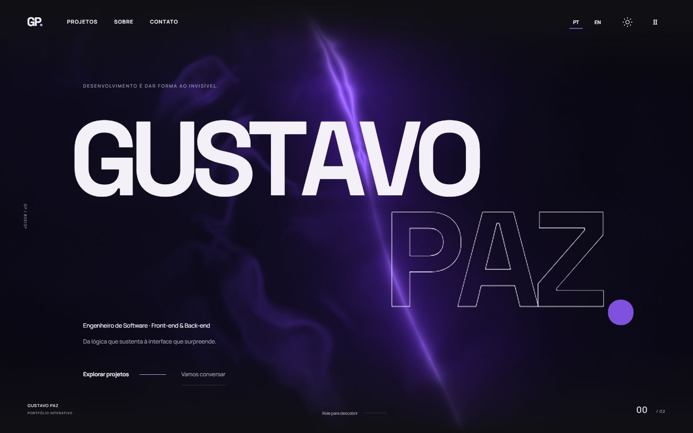

# Gustavo Paz — Portfólio profissional

Experiência interativa em português e inglês para apresentar minha trajetória em desenvolvimento, projetos de front-end e back-end e jogos de navegador.

[Abrir portfólio](https://gustapaz.github.io/pt/) · [English](https://gustapaz.github.io/en/) · [LinkedIn](https://www.linkedin.com/in/gustapaz/)



## Experiência

- Abertura tipográfica autoral, animações vinculadas à rolagem nativa e temas claro/escuro.
- Catálogo dinâmico do GitHub com busca, filtros, ordenação e visualização em galeria ou lista.
- Destaques sorteados por visita e botão para explorar outra seleção.
- Capturas reais das demos, com geração automática no GitHub Actions e variantes WebP.
- Trajetória, competências, contato profissional e currículo bilíngue para impressão.
- Navegação por teclado, movimento reduzido e preferência para mostrar a barra de rolagem.

## Executar

Requisitos: Node.js 24 e npm.

```sh
npm ci
npm run dev
```

```sh
npm test
npm run check
npm audit --audit-level=high
npm run build
npm run preview
```

O servidor de desenvolvimento usa a porta 4327; o preview usa 4328. O build utiliza o catálogo versionado e não precisa de credenciais.

## Projetos e previews automáticos

`npm run sync` atualiza o catálogo público e procura capturas reais nos repositórios. O workflow do Pages roda também a cada seis horas, sujeito a atrasos do agendador. Novos projetos precisam ser públicos, originais e ter a demo HTTPS no campo Website do GitHub. Forks, projetos arquivados e repositórios de perfil/portfólio são excluídos.

Para demos sem screenshot, o Chromium do CI gera uma captura pública, sem login, formulários ou sessões pessoais. A política atual permite o Pages de gustapaz e os hosts de demonstração `*-gustapaz.starrylinen.chatgpt.site`. Outros provedores precisam de uma regra específica ou de uma captura real versionada. Capturas ao vivo são renovadas após alterações no repositório ou sete dias. Falhas preservam a última imagem válida. Jogos podem fornecer uma captura real de gameplay em `docs/public-gameplay.png`.

As imagens geradas são publicadas no Pages e recuperadas no build seguinte, sem commits automáticos de bots. O token temporário de leitura do Actions existe somente no passo de sincronização, nunca no cliente. A captura usa sandbox do Chromium, bloqueia escrita e limita destinos de rede.

## Tecnologia e publicação

Astro, TypeScript, GSAP/ScrollTrigger, WebGL e CSS. Exportação estática no GitHub Pages, com runners Ubuntu padrão em repositório público. Sem serviço pago de captura, cartão ou faturamento. O site não possui servidor, banco ou autenticação próprios.

## Licenças

Código sob MIT. Fontes, GSAP e demais materiais mantêm suas licenças e atribuições nos [avisos publicados](https://gustapaz.github.io/third-party.txt) e em `docs/assets.md`. Screenshots representam os projetos reais; não atribuem uma licença geral a todos os materiais exibidos.
